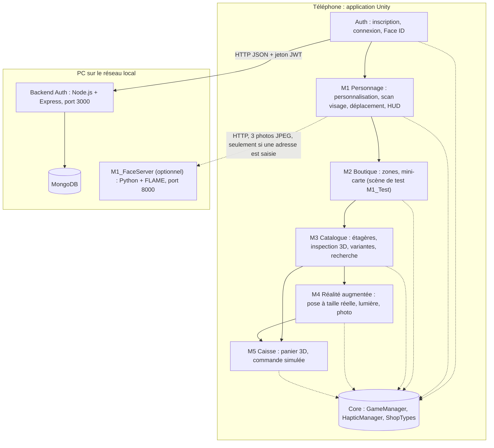
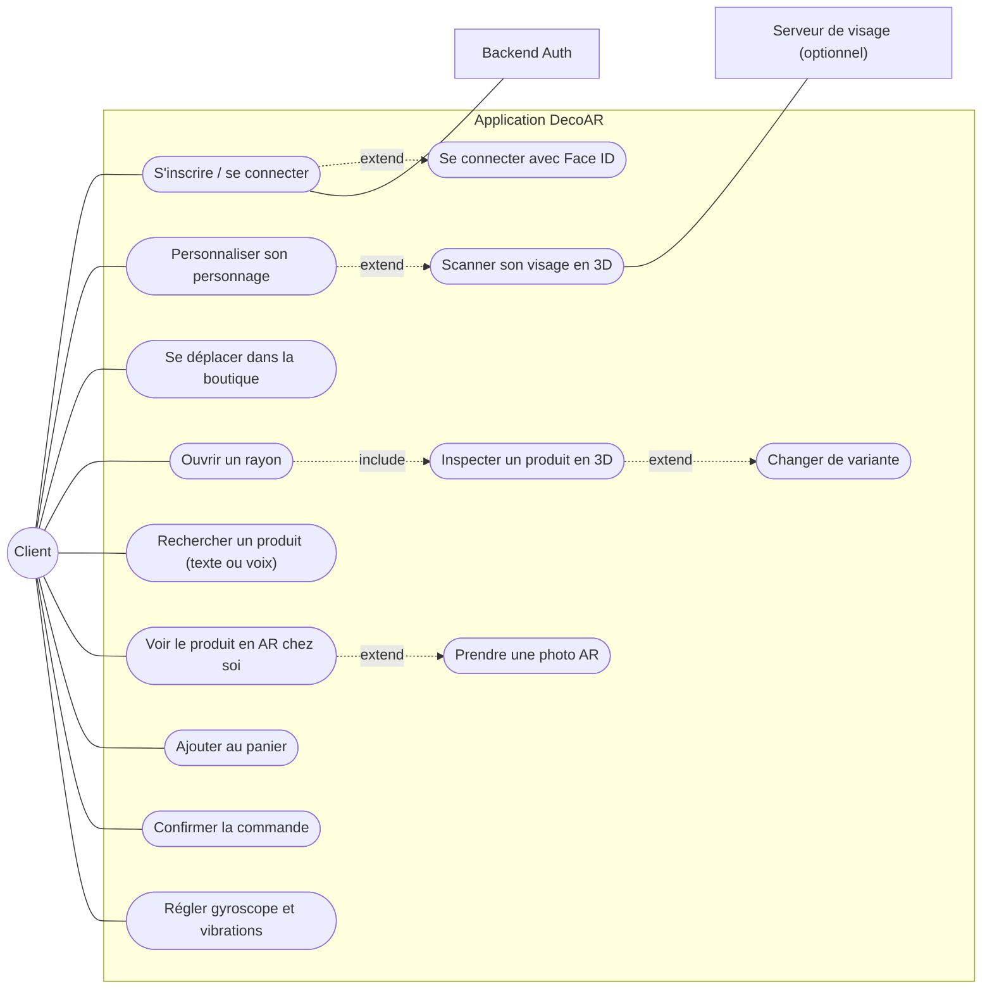
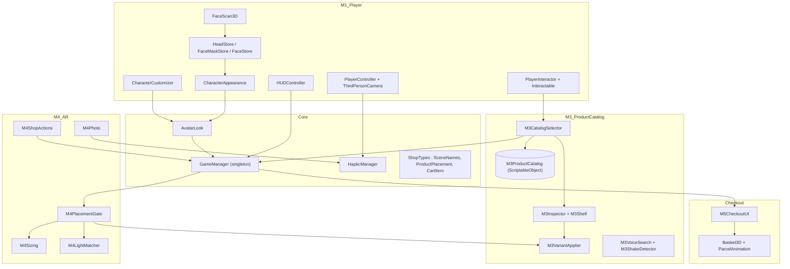
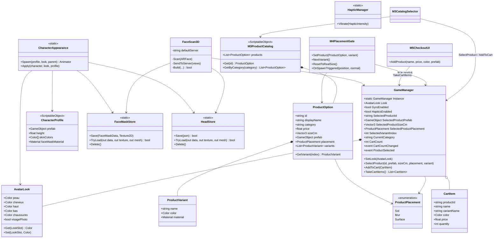
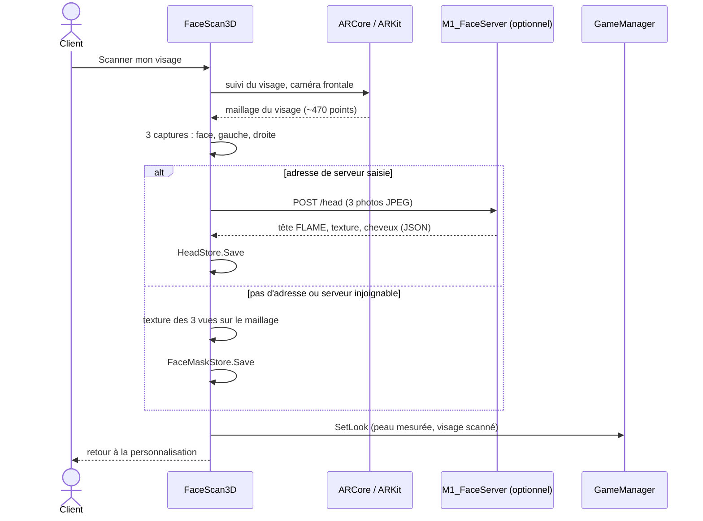
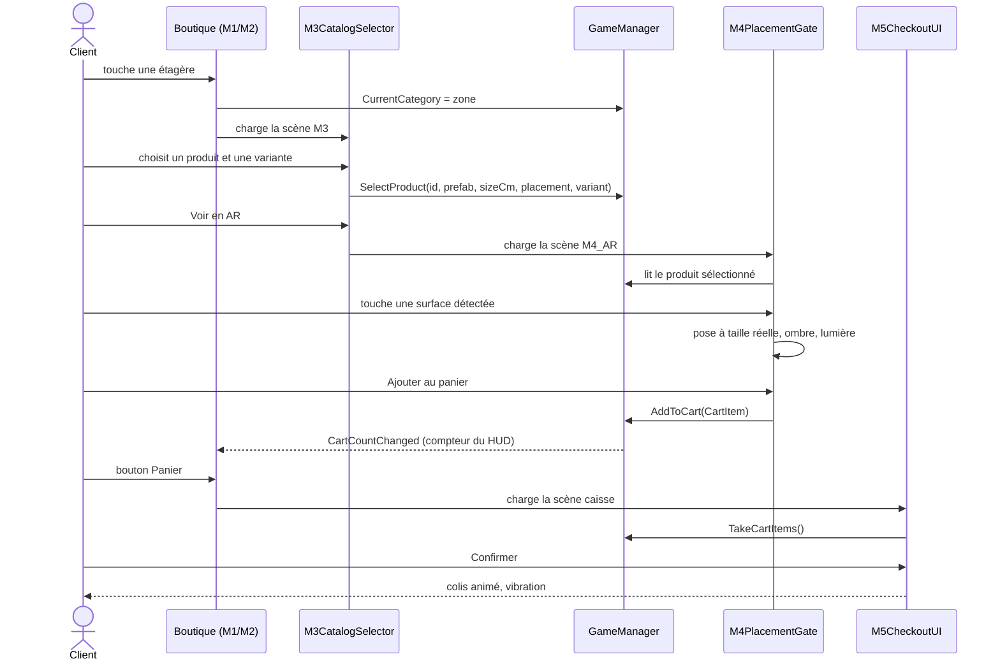
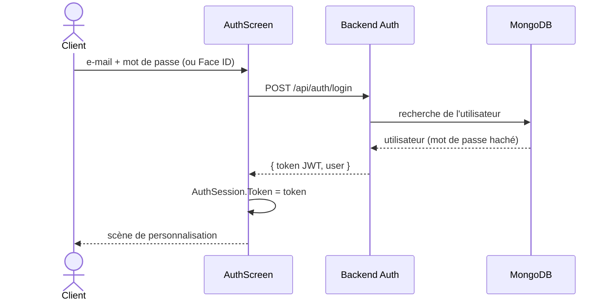
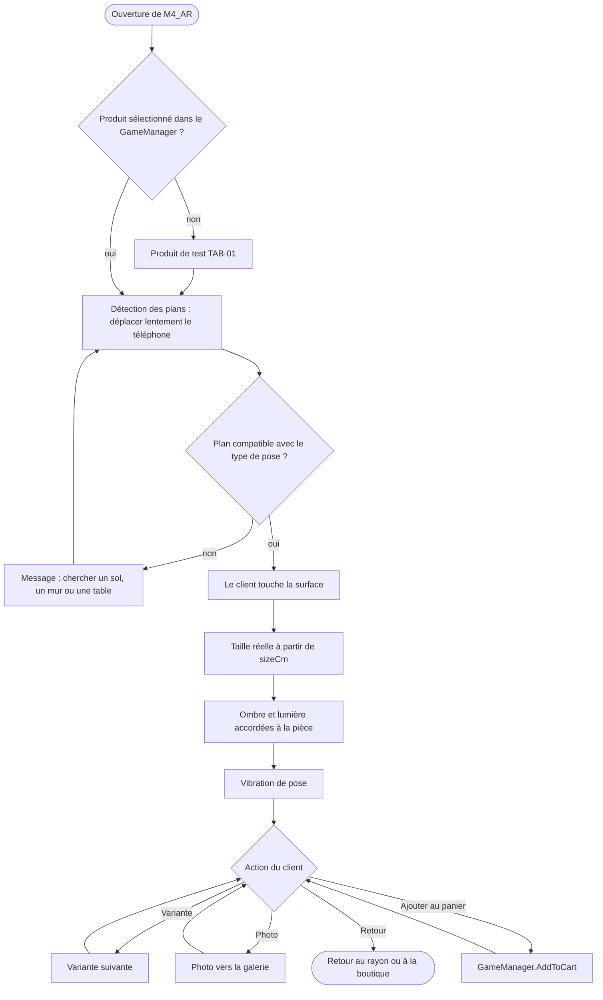
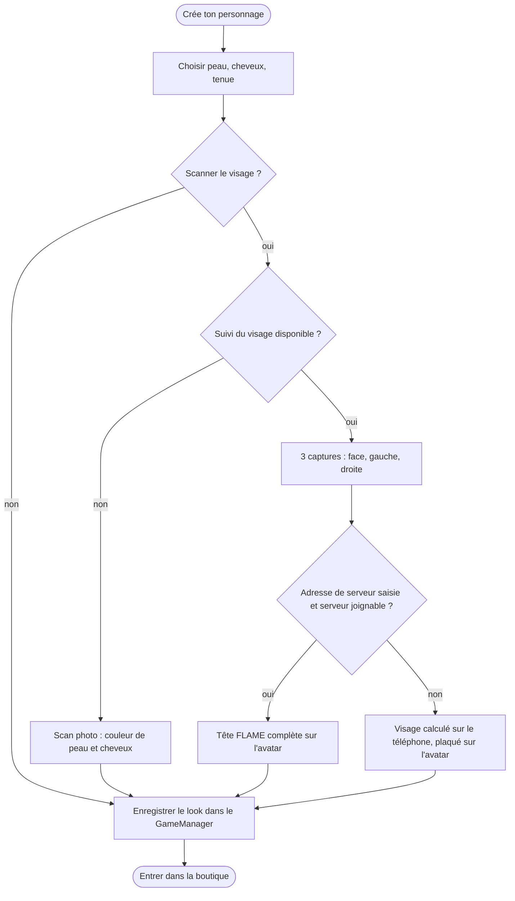

# DecoAR — System Design

Ce document décrit l'architecture technique de DecoAR : les composants de l'application, leurs responsabilités, la façon dont ils communiquent, les données manipulées et les technologies utilisées. Il sert de référence commune à toute l'équipe.

> Les diagrammes sont écrits en Mermaid : GitHub les affiche directement. Dans un autre éditeur, utiliser un aperçu Markdown compatible Mermaid.

## Sommaire

1. [Présentation du système](#1-présentation-du-système)
2. [Architecture globale](#2-architecture-globale)
3. [Technologies utilisées](#3-technologies-utilisées)
4. [Modules et responsabilités](#4-modules-et-responsabilités)
5. [Diagramme de cas d'utilisation](#5-diagramme-de-cas-dutilisation)
6. [Diagramme de composants](#6-diagramme-de-composants)
7. [Diagramme de classes](#7-diagramme-de-classes)
8. [Diagrammes de séquence](#8-diagrammes-de-séquence)
9. [Diagrammes d'activité](#9-diagrammes-dactivité)
10. [Données et sauvegarde](#10-données-et-sauvegarde)
11. [Capteurs](#11-capteurs)
12. [Organisation des dossiers Unity](#12-organisation-des-dossiers-unity)
13. [Principes de conception appliqués](#13-principes-de-conception-appliqués)
14. [Game design et system design](#14-game-design-et-system-design)
15. [Limites et évolutions](#15-limites-et-évolutions)

---

## 1. Présentation du système

DecoAR est une application mobile 3D et AR de vente de décoration. Le client :

1. se connecte (mot de passe ou Face ID) ;
2. crée un personnage à son image : couleurs, tenue, scan 3D de son visage ;
3. se déplace dans une boutique 3D avec ce personnage ;
4. inspecte les produits d'un rayon en 3D et choisit une variante ;
5. pose le produit dans sa pièce en réalité augmentée, à taille réelle ;
6. ajoute les produits au panier et confirme une commande simulée.

Hors périmètre : paiement réel, back-office marchand, synchronisation des commandes en ligne.

## 2. Architecture globale

L'application est un **client Unity unique** découpé en modules. Les modules ne s'appellent pas directement : ils partagent un état commun, le `GameManager`, et passent d'une scène à l'autre par leur nom (`SceneNames`). Deux services tournent sur un PC du réseau local pour ce que le téléphone ne fait pas seul.



Traits pleins : enchaînement des scènes. Pointillés vers Core : lecture et écriture de l'état partagé.

## 3. Technologies utilisées

| Domaine | Technologie |
| --- | --- |
| Moteur | Unity 6 (6000.6) |
| Langage | C# |
| IDE | Visual Studio (solution `DecoAR-2026.slnx`) |
| Rendu | Universal Render Pipeline 17.6 |
| Réalité augmentée | AR Foundation 6.6.2, ARCore 6.6.2 (Android), ARKit 6.6.2 (iOS), XR Management 4.7 |
| Interaction XR | XR Interaction Toolkit 3.6.1 |
| Entrées | Input System 1.20 (tactile, joystick virtuel, clavier dans l'éditeur) |
| Interface | Unity UI (uGUI) et TextMeshPro |
| Personnage | Avatar MetaPerson, rig Humanoid, animations Mixamo |
| Galerie | Unity Native Gallery (photos prises en AR) |
| Données de jeu | ScriptableObject (catalogue produits, profil du personnage), PlayerPrefs, fichiers JSON / PNG locaux |
| Backend Auth | Node.js, Express, MongoDB, JWT |
| Serveur de visage (optionnel) | Python, FastAPI, Uvicorn, OpenCV, NumPy, MediaPipe Face Landmarker, modèle FLAME |
| Versionnage | Git, GitHub, Git LFS (modèles, textures, sons) |
| Cibles | Android (APK), iOS (projet Xcode) |

## 4. Modules et responsabilités

| Module | Responsabilité | Scènes | Scripts principaux | État |
| --- | --- | --- | --- | --- |
| **Core** | État partagé entre scènes, vibrations, types communs | aucune (créé automatiquement) | `GameManager`, `AvatarLook`, `HapticManager`, `ShopTypes` | Disponible |
| **Auth** | Inscription, connexion, Face ID, session | `Auth` | `AuthScreen`, `AuthApi`, `AuthSession`, `BiometricAuth` | Branche `salsabil-hafsi` |
| **M1 Personnage** | Personnalisation, scan du visage, déplacement, caméra 3e personne, interactions, HUD | `M1_Personnalisation`, `M1_ScanVisage`, `M1_Test` | `CharacterCustomizer`, `FaceScan3D`, `CharacterAppearance`, `PlayerController`, `ThirdPersonCamera`, `PlayerInteractor`, `HUDController` | Disponible |
| **M2 Boutique** | Boutique en zones, ambiance, mini-carte | `M1_Test` sert de boutique | `Interactable`, `M3ShelfEntrance` | À intégrer |
| **M3 Catalogue** | 39 produits en 7 zones, étagère, inspection 360°, variantes, fiche, recherche texte et vocale, secousse | `M3` | `M3ProductCatalog`, `M3CatalogSelector`, `M3Shelf`, `M3Inspector`, `M3VariantApplier`, `M3VoiceSearch`, `M3ShakeDetector` | Disponible |
| **M4 AR** | Pose sur sol, mur ou table à taille réelle, ombre, lumière, variante, photo, panier | `M4_AR` | `M4PlacementGate`, `M4Sizing`, `M4LightMatcher`, `M4Photo`, `M4ShopActions` | Disponible |
| **M5 Caisse** | Vendeur, panier 3D, colis animé, commande simulée en TND | `caisse` | `M5CheckoutUI`, `Basket3D`, `ParcelAnimation`, `VendorNPC` | Première version |

Chaque module a aussi ses **outils d'éditeur** (dossier `Editor/`) qui regénèrent ses scènes et ses ressources : menus `DecoAR > M1`, `M3`, `M4`, `M5`, `Auth`.

## 5. Diagramme de cas d'utilisation



## 6. Diagramme de composants



## 7. Diagramme de classes

Classes principales et leurs relations (attributs et méthodes simplifiés).



## 8. Diagrammes de séquence

### 8.1 Scan du visage (M1)

Le visage est calculé sur le téléphone par défaut. Le serveur FLAME n'est appelé que si une adresse est saisie sur l'écran du scan ; en cas d'échec, l'application revient au calcul local.



### 8.2 Du rayon à l'AR puis à la caisse (M3, M4, M5)



### 8.3 Connexion (Auth)



## 9. Diagrammes d'activité

### 9.1 Pose d'un produit en AR (M4)



### 9.2 Personnalisation et scan (M1)



## 10. Données et sauvegarde

| Donnée | Emplacement | Format | Durée de vie |
| --- | --- | --- | --- |
| Catalogue des produits | `Assets/DecoAR/M3_ProductCatalog/Data/M3_ProductCatalog.asset` | ScriptableObject | Livré avec l'application |
| Profil du personnage | `Assets/DecoAR/M1_Player/Data` | ScriptableObject | Livré avec l'application |
| Apparence, gyroscope, vibrations | `PlayerPrefs` (`DecoAR.Look`, `DecoAR.GyroEnabled`, `DecoAR.HapticsEnabled`) | JSON et entiers | Persistante |
| Adresse du serveur de visage | `PlayerPrefs` (`DecoAR.HeadServer.v2`), vide par défaut | Texte | Persistante |
| Visage calculé sur le téléphone | Stockage privé de l'application (`FaceMaskStore`) | Maillage JSON + PNG | Persistante |
| Tête FLAME (option serveur) | Stockage privé : `decoar_tete3d.json`, `decoar_tete3d.png`, `decoar_cheveux3d.png` | JSON + PNG | Persistante |
| Photos reçues par le serveur de visage | PC : `M1_FaceServer/sortie/derniere_requete/` | JPEG | Écrasées à chaque scan |
| Comptes utilisateurs | MongoDB | Documents, mot de passe haché | Persistante |
| Session de connexion | `AuthSession` (jeton JWT) | Texte | Session |
| Produit sélectionné, panier, position dans la boutique | `GameManager` (mémoire) | Objets C# | Session |
| Photos AR | Galerie du téléphone | Image | Persistante |

## 11. Capteurs

| Capteur | Utilisation | Module |
| --- | --- | --- |
| Caméra frontale + suivi du visage | Maillage et texture du visage | M1 |
| Caméra arrière + détection des plans | Pose des produits | M4 |
| Estimation de la lumière | Éclairage du produit accordé à la pièce | M4 |
| Gyroscope | Orientation de la caméra (activable dans les réglages) | M1 |
| Accéléromètre | Secouer pour reposer le produit inspecté | M3 |
| Microphone | Recherche vocale (iOS) | M3 |
| Vibreur | Collision, pose AR, scan, panier | Tous, via `HapticManager` |
| Biométrie (Face ID) | Connexion sans mot de passe | Auth |

## 12. Organisation des dossiers Unity

Le projet est rangé **par module** plutôt que par type de fichier : chaque module contient ses propres scripts, scènes, prefabs et ressources, ce qui permet à chaque membre de l'équipe de travailler sans toucher aux dossiers des autres.

```text
Assets/
├── DecoAR/
│   ├── Core/
│   │   └── Scripts/          # GameManager, AvatarLook, HapticManager, ShopTypes
│   ├── Auth/                 # (branche salsabil-hafsi) inscription, connexion, Face ID
│   ├── M1_Player/
│   │   ├── Animations/       # contrôleur d'animation (idle, marche, interaction)
│   │   ├── Data/             # CharacterProfile
│   │   ├── Editor/           # générateurs de scènes, import MetaPerson / Mixamo
│   │   ├── Materials/
│   │   ├── Mixamo/           # avatar et animations
│   │   ├── Prefabs/          # M1_PlayerRig
│   │   ├── Scenes/           # M1_Personnalisation, M1_ScanVisage, M1_Test
│   │   ├── Scripts/          # personnage, scan, déplacement, caméra, HUD
│   │   ├── Shaders/
│   │   └── UI/
│   ├── M3_ProductCatalog/
│   │   ├── Data/             # M3_ProductCatalog.asset
│   │   ├── Editor/           # génération des modèles, du catalogue et de la scène
│   │   ├── Materials/
│   │   ├── Prefabs/
│   │   ├── Scenes/           # M3
│   │   └── Scripts/
│   └── M4_AR/
│       ├── Editor/
│       ├── Materials/
│       ├── Prefabs/
│       ├── Scenes/           # M4_AR
│       ├── Scripts/
│       └── Shaders/
├── Checkout/                 # M5 : Scenes/caisse, Scripts, Prefabs, Audio, Animations
├── Plugins/                  # code natif iOS / Android (reconnaissance vocale, galerie)
└── Settings/                 # profils URP
Backend/                      # (branche salsabil-hafsi) API Node.js + MongoDB
M1_FaceServer/                # serveur Python de tête 3D (optionnel)
docs/                         # ce document
```

## 13. Principes de conception appliqués

| Principe | Où il est appliqué |
| --- | --- |
| **État partagé unique (singleton)** | `GameManager` créé avant la première scène et conservé entre les scènes : chaque scène peut être lancée seule dans l'éditeur. |
| **Faible couplage entre modules** | Les modules ne se référencent pas : ils passent par le `GameManager` et chargent la scène suivante par `SceneNames`. Un module peut être remplacé (par exemple `M1_Test` par la future boutique M2) en changeant un seul nom. |
| **Communication par événements** | `CartCountChanged`, `ProductSelected`, `CartItemAdded`, `GyroChanged`, `HapticsChanged` : le HUD et les autres écrans réagissent sans être appelés directement. |
| **Données séparées du code (ScriptableObject)** | Catalogue des produits et profil du personnage modifiables dans l'éditeur sans toucher au code. |
| **Service unique pour un besoin transversal** | `HapticManager` pour toutes les vibrations, avec respect du réglage de l'utilisateur. |
| **Dégradation progressive** | Scan : visage sur le téléphone si pas de serveur ; scan photo si pas de suivi du visage ; produit de test si M4 est lancé seul. |
| **Scènes générées par l'éditeur** | Les menus `DecoAR > ...` reconstruisent les scènes : moins de conflits Git sur les fichiers `.unity`. |
| **Adaptation à l'écran** | `ResponsiveLayout` et `M3ResponsiveLayout` changent la disposition en portrait et en paysage. |

## 14. Game design et system design

| Game design (pour le joueur) | System design (technique) |
| --- | --- |
| Créer un personnage à son image | `CharacterCustomizer`, `FaceScan3D`, `CharacterAppearance`, stockage du visage |
| Se promener dans une boutique | `PlayerController`, `ThirdPersonCamera`, `VirtualJoystick`, `Interactable` |
| Examiner un produit sous tous les angles | `M3Inspector`, gestes tactiles, `M3VariantApplier` |
| Voir le produit chez soi, à la bonne taille | AR Foundation, `M4PlacementGate`, `M4Sizing`, `M4LightMatcher` |
| Remplir son panier et commander | `GameManager.AddToCart`, `M5CheckoutUI`, `Basket3D` |
| Retrouver son personnage à chaque lancement | `PlayerPrefs`, fichiers du visage dans le stockage privé |

## 15. Limites et évolutions

- **M2** n'est pas encore intégré : `M1_Test` sert de boutique (`SceneNames.Shop`).
- **Panier en mémoire** : il disparaît à la fermeture ; M5 devra le rendre persistant (livraison, historique).
- **Auth** et son backend sont sur la branche `salsabil-hafsi`, pas encore fusionnés.
- **Réseau** : HTTP non chiffré sur le réseau local ; une version publiée demanderait HTTPS et un serveur hébergé.
- **Identifiant Android** encore celui du modèle Unity (`com.unity.template.ar_mobile`) ; à remplacer avant distribution.
- **Serveur FLAME** : tête complète mais un PC et environ une minute sont nécessaires ; le visage calculé sur le téléphone est donc le choix par défaut.
